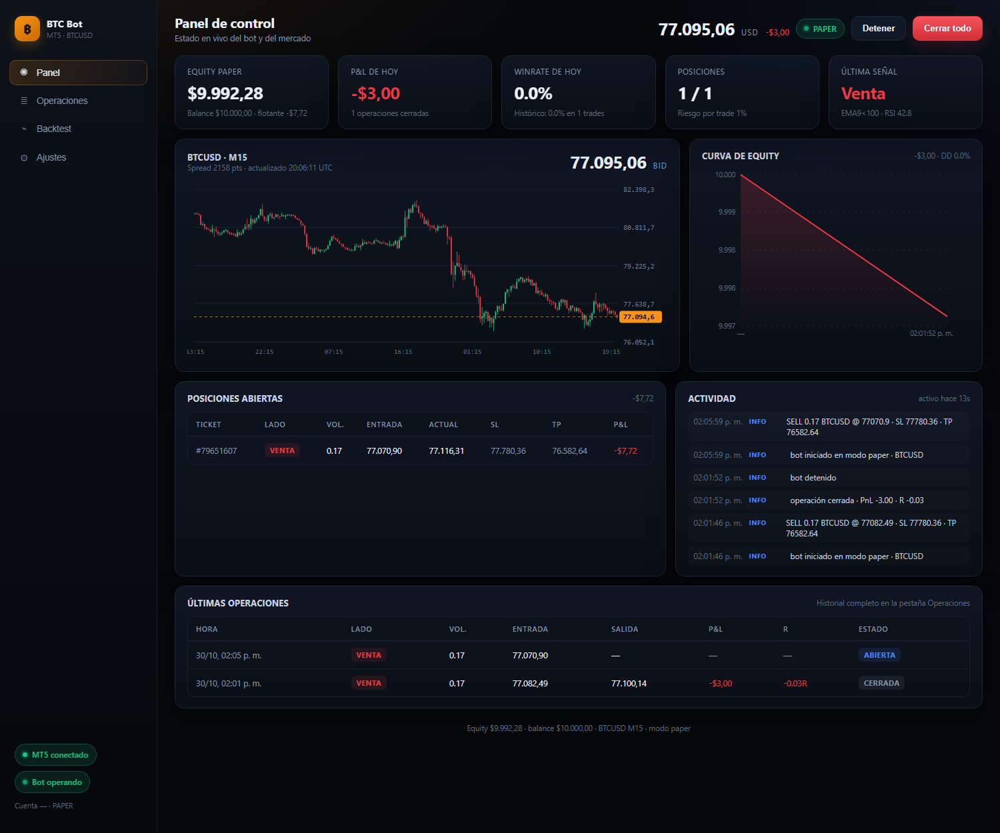
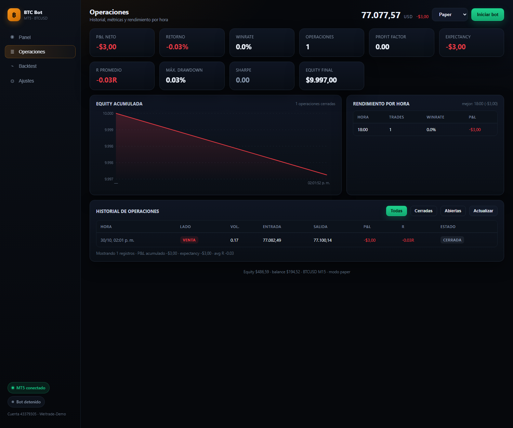
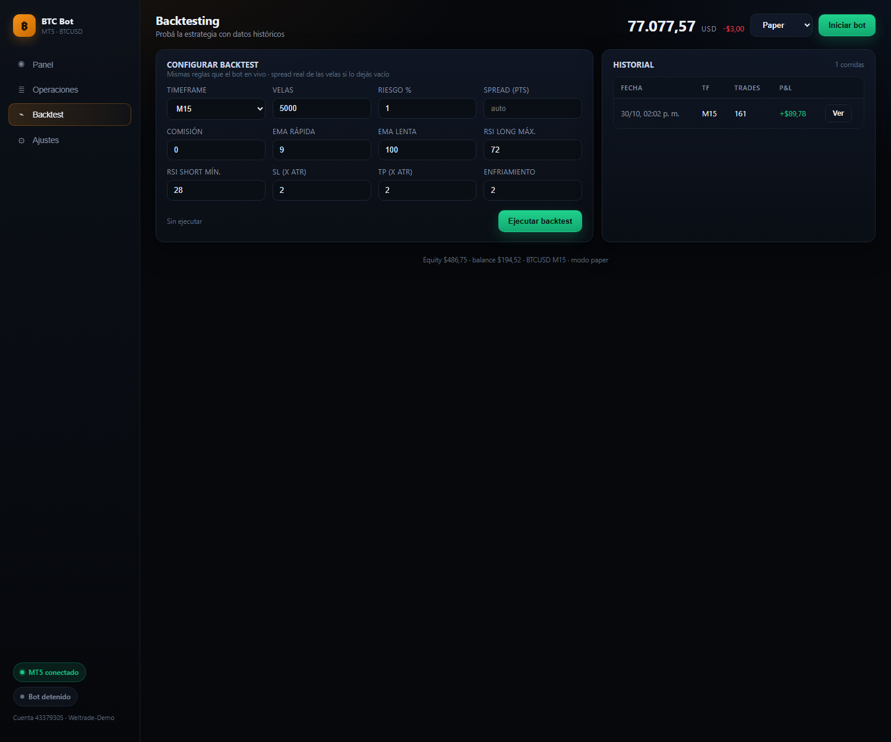
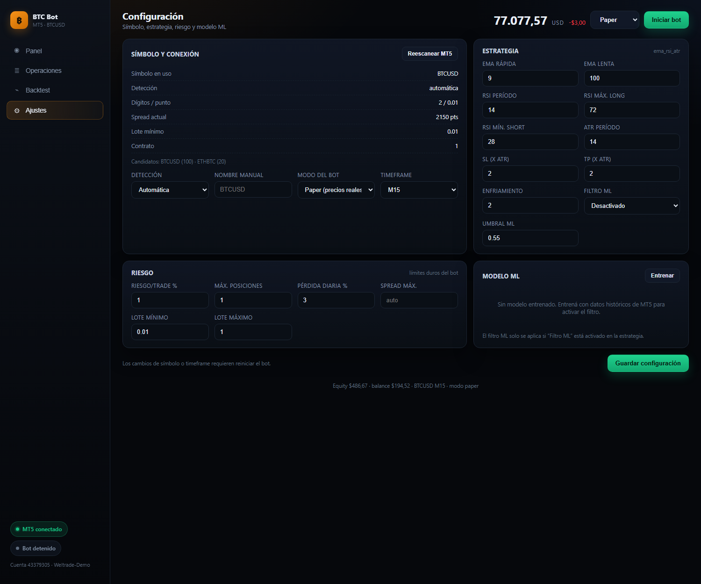

# BTC Bot · MT5 + Python + React

Bot de trading automatizado para **BTC** sobre MetaTrader 5, con backend en Python
(estrategia, riesgo, ejecución, backtesting y ML) y un panel web en React para
monitorear y probar todo desde el navegador.



---

## Qué incluye

| Módulo | Qué hace |
|---|---|
| **Conector MT5** | Se conecta al terminal, **detecta solo el símbolo de BTC** (BTCUSD, BTCUSD.m, XBTUSD…) y lo hace visible en Market Watch. |
| **Motor en vivo** | Evalúa la estrategia en cada vela cerrada, calcula tamaño de posición por riesgo, abre órdenes con SL/TP y gestiona la salida. |
| **Riesgo** | Riesgo % por operación, máximo de posiciones, límite de pérdida diaria, máximo de trades por día, drawdown de cuenta, margen libre mínimo, filtro de spread, lote mínimo/máximo. |
| **Gestión de salida** | Break-even, trailing stop y cierres parciales por ATR/R, idénticos en vivo y en backtest. |
| **Backtester** | Bar-a-bar con las **mismas funciones** que el bot en vivo, spread real de las velas y ejecución en la vela siguiente. |
| **Métricas** | Winrate, profit factor, expectancy, R promedio, drawdown, Sharpe, rachas, rendimiento por hora y por día. |
| **ML (opcional)** | Regresión logística en numpy con validación **walk-forward**; se usa como filtro de señales. |
| **Dashboard** | React + Vite + Recharts: panel en vivo, historial, backtesting y configuración. |
| **Persistencia** | SQLite (`backend/data/bot.db`): trades, corridas de backtest y configuración. |

## Capturas

| Operaciones | Backtesting | Ajustes |
|---|---|---|
|  |  |  |

---

## Requisitos

- **Windows** (la API de MetaTrader 5 solo corre ahí).
- **MetaTrader 5** instalado, abierto y con la sesión iniciada (demo o real).
- **Python 3.10+** (probado con 3.14).
- **Node.js 20+** y npm (solo para el frontend).

## Instalación rápida (Windows)

1. Descargá el repo: `git clone https://github.com/EdsonAP1/btc.git` (o *Code → Download ZIP*).
2. **Doble clic en `setup.bat`** (una sola vez).
3. **Doble clic en `start.bat`** → se abre <http://127.0.0.1:8000>.

`setup.bat` verifica Python 3.10+ y Node 18+, crea el entorno `.venv`, instala las
dependencias de Python y del frontend, compila el panel y genera `backend\config.json`.
Es **idempotente**: si lo corrés de nuevo, saltea lo que ya está hecho.

`start.bat` levanta el servidor en una ventana aparte (con logs) y abre el panel en
el navegador. Para frenarlo, cerrá esa ventana o presioná `Ctrl+C`.

> Si Windows SmartScreen bloquea el `.bat`, elegí *Más información → Ejecutar de todas formas*.
> Si no tenés MetaTrader 5, el modo **Simulado** funciona igual.

## Instalación manual

```powershell
# 1) Backend
python -m venv .venv
.venv\Scripts\python -m pip install -r backend\requirements.txt

# 2) Frontend
cd frontend
npm install
npm run build
```

## Cómo correrlo

**Opción A — un solo servidor (recomendado para usar el bot):**

```powershell
.venv\Scripts\python -m uvicorn app.main:app --app-dir backend --host 127.0.0.1 --port 8000
```

**Opción B — desarrollo (hot reload):**

```powershell
# terminal 1
.venv\Scripts\python -m uvicorn app.main:app --app-dir backend --reload --port 8000

# terminal 2
cd frontend
npm run dev          # http://localhost:5173 (proxy a :8000)
```

También hay scripts listos: `scripts\start-backend.ps1`, `scripts\start-frontend.ps1`
y `scripts\run-tests.ps1` (usan `.venv` automáticamente si existe).


## Uso del panel

1. **Panel**: precio en vivo, velas, equity, P&L del día, winrate, posiciones abiertas y actividad.
2. **Operaciones**: historial completo, métricas y rendimiento por hora.
3. **Backtest**: elegí timeframe, cantidad de velas y parámetros → *Ejecutar backtest*.
4. **Ajustes**: símbolo, estrategia, riesgo y modelo ML.

En la barra superior elegís el **modo** y arrancás o detenés el bot:

| Modo | Datos | Ejecución |
|---|---|---|
| `live` | precios reales de MT5 | **órdenes en la cuenta que tengas logueada** (demo o real) |
| `paper` | precios reales de MT5 | simulada, balance virtual de USD 10.000 |
| `sim` | serie sintética | simulada (sin MT5) |

El bot **no elige demo ni real**: opera sobre la cuenta que esté logueada en el
terminal. Al arrancar lee `account_info()` y muestra el tipo (`DEMO` / `REAL`) en
el panel. Si detecta una cuenta **REAL**, pide confirmación explícita antes de
enviar la primera orden (en la API: `{"mode": "live", "confirm_real": true}`).

> ⚠️ Con una cuenta demo no hay riesgo; con una real, sí. El bot nunca cambia de
> cuenta por su cuenta: eso lo decidís vos en MT5.

## Detección automática del símbolo

Al conectar, el bot recorre `mt5.symbols_get()`, filtra nombres con `BTC` / `XBT` /
`BITCOIN` y los puntúa (nombre exacto, sufijo del broker, visible, operable). Se
queda con el mejor y lo selecciona en Market Watch. Si no encuentra ninguno, prueba
la lista de `symbol.fallbacks`. Todo queda visible en **Ajustes → Símbolo y conexión**.

## Estrategia por defecto

`ema_rsi_atr`:

- **Tendencia**: EMA rápida (9) por encima/debajo de la EMA lenta (100) y precio del lado correcto.
- **Filtro RSI** (14): evita comprar en sobrecompra extrema y vender en sobreventa extrema.
- **Filtro de volatilidad**: exige ATR mínimo.
- **SL/TP**: 2× ATR cada uno.
- **Enfriamiento**: 2 velas entre operaciones.
- **Opcional**: filtro de tendencia de largo plazo (`trend_ema`) y confirmación del modelo ML.

Los parámetros se editan en **Ajustes** o en `backend/config.json`. El *sweep* de
desarrollo mostró que timeframes altos (H4) tienen mejor relación riesgo/beneficio,
pero el default queda en **M15** para que el bot tenga actividad visible. Ajustalo
con el backtester antes de ir a real.

## Gestión de salida

Todas las reglas viven en `management` dentro de la config y se aplican **igual**
en el motor en vivo y en el backtester (`app/core/management.py`):

| Regla | Default | Qué hace |
|---|---|---|
| **Break-even** | a 2 ATR | Cuando el trade gana 1R, mueve el SL a entrada + 0,05 ATR. |
| **Trailing** | desde 2 ATR | A partir de 1R, el SL sigue al extremo a 2 ATR de distancia (nunca retrocede). |
| **Parciales** | 50% a 0,5R | Cierra la mitad de la posición y deja correr el resto. |

Con SL de 2 ATR, **1R = 2 ATR**. Si cambiás `sl_atr`, ajustá los triggers en
consecuencia (Ajustes → Gestión de salida).

Impacto medido con el spread real del broker (5.000 velas, riesgo 1%):

| Timeframe | Sin gestión | Con gestión |
|---|---|---|
| M15 | PF 1,06 · DD 12,9% | PF 1,05 · DD **10,3%** |
| H1 | PF 0,92 · DD 17,7% | PF **1,03** · DD **10,8%** |
| H4 | PF 1,10 · DD 9,2% | PF **1,27** · DD **7,3%** |

## Límites duros

| Límite | Default | Comportamiento |
|---|---|---|
| `max_trades_per_day` | 6 | Bloquea entradas nuevas después de N trades del día. |
| `max_drawdown_pct` | 15% | Mide desde el pico de equity guardado; bloquea entradas y, con `halt_on_drawdown`, **detiene el bot**. |
| `min_free_margin_pct` | 30% | Exige que quede al menos ese % de margen libre después de abrir. |
| `max_daily_loss_pct` | 3% | Corte por pérdida del día. |
| `max_spread_points` | auto | 3× el spread típico del símbolo. |

El pico de equity se persiste en SQLite (`kv`), así el drawdown sobrevive reinicios.

## Backtester: supuestos

- La señal se evalúa al **cierre** de la vela `i` y se ejecuta al **open** de `i+1`.
- Si en una vela se tocan SL y TP, se asume **SL** (peor caso).
- El spread se paga en entrada y salida; si no lo especificás, se usa la **mediana
  del spread de las propias velas**.
- El tamaño de posición se recalcula con el equity del momento (interés compuesto).

## Métricas

- **Winrate**: % de operaciones ganadoras.
- **Profit factor**: ganancia bruta / pérdida bruta (>1 es positivo).
- **Expectancy**: resultado medio por operación.
- **R promedio**: P&L dividido por el riesgo asumido en cada trade.
- **Drawdown**: caída máxima desde el pico de equity (absoluta y %).
- **Sharpe**: retornos diarios anualizados (365 días).

## Modelo ML

- **Features**: retornos 1/3/5, separación de EMAs, RSI, ATR%, posición vs EMA,
  cuerpo/rango de la vela, volumen relativo y codificación cíclica de hora/día.
- **Modelo**: regresión logística entrenada con descenso de gradiente (numpy puro).
- **Validación**: walk-forward en 4 folds; se reporta accuracy fuera de muestra y
  el *base rate* para comparar.
- **Uso**: con `strategy.use_ml = true`, la señal solo se acepta si la probabilidad
  del modelo la confirma.
- Se entrena desde **Ajustes → Modelo ML → Entrenar** (o `POST /api/ml/train`).

## API

| Método | Endpoint | Descripción |
|---|---|---|
| GET | `/api/health` | estado del servicio y de MT5 |
| GET | `/api/status` | estado completo del bot (lo usa el panel) |
| POST | `/api/bot/start` | `{"mode": "paper"}` |
| POST | `/api/bot/stop` | `{"close_positions": false}` |
| POST | `/api/bot/panic` | cierra todo y detiene |
| GET | `/api/candles?timeframe=M15&limit=400` | velas |
| GET | `/api/trades?limit=100&status=closed` | historial |
| GET | `/api/metrics` | métricas agregadas |
| GET/PATCH | `/api/config` | configuración |
| GET | `/api/symbols/btc` | símbolo detectado y candidatos |
| POST | `/api/symbols/rescan` | vuelve a detectar |
| POST | `/api/backtest` | corre un backtest |
| GET | `/api/backtests` · `/api/backtests/{id}` | historial de corridas |
| GET | `/api/ml/status` · POST `/api/ml/train` | modelo ML |
| WS | `/api/ws` | estado en vivo (status, señales, trades, logs) |

Documentación interactiva: <http://127.0.0.1:8000/docs>

## Estructura

```
btc/
├── backend/
│   ├── app/
│   │   ├── main.py          # FastAPI + estáticos
│   │   ├── api.py           # rutas REST + WebSocket
│   │   ├── engine.py        # motor en vivo
│   │   ├── market.py        # datos MT5 con fallback simulado
│   │   ├── config.py        # defaults + config.json
│   │   ├── db.py            # SQLite
│   │   ├── core/
│   │   │   ├── indicators.py
│   │   │   ├── strategy.py  # señal (única fuente de verdad)
│   │   │   ├── risk.py
│   │   │   ├── broker.py    # MT5Broker / PaperBroker
│   │   │   ├── backtester.py
│   │   │   └── metrics.py
│   │   ├── mt5/
│   │   │   ├── client.py    # conexión, símbolos, órdenes
│   │   │   ├── symbols.py   # scoring de símbolos BTC
│   │   │   └── feed.py      # datos sintéticos
│   │   └── ml/
│   │       ├── features.py
│   │       └── model.py
│   └── tests/               # pytest (20 tests)
├── frontend/
│   └── src/
│       ├── App.jsx
│       ├── api.js
│       ├── hooks/useLive.js
│       ├── components/
│       └── views/
├── scripts/                 # smoke test, sweep, arranque
└── docs/                    # capturas
```

## Tests

```powershell
cd backend
python -m pytest tests -q
```

Cubren: detección de símbolos, métricas, riesgo, backtester (contabilidad,
spread) y el ciclo completo del motor (abrir → cerrar operación).

## Limitaciones y próximos pasos

- Una sola estrategia; el motor está preparado para agregar más (`strategy.name`).
- Sin optimizador walk-forward todavía.
- Sin autenticación en la API: pensada para `127.0.0.1`. No la expongas a internet.
- El bot necesita el terminal MT5 abierto y logueado.
- Ideas: segunda y tercera estrategia (Donchian / reversión), optimizador
  walk-forward, notificaciones (Telegram), multi-símbolo y Docker.
